# Sami (昕雨) Zhang

**Database systems · Computer architecture · Accelerated computing**

Undergraduate at the **University of Michigan**, studying Computer Science and
Mathematical Sciences, with a minor in Electrical Engineering.

I study how analytical queries execute on specialized hardware—from operator
semantics to kernels, memory layouts, and data movement.

[Email](mailto:zhangxinyu040326@163.com) ·
[LinkedIn](https://www.linkedin.com/in/xinyu-zhang1)

---

### Research

Exploring accelerator-native database execution through correctness checks,
operator benchmarks, and hardware-aware profiling. Active faculty-supervised
research; code and unpublished measurements remain private.

A closer look · matrix multiplication on a systolic array

<picture>
  <source media="(max-width: 600px)" srcset="./assets/systolic-array-mobile.svg">
  
</picture>

A conceptual trace: 27 multiply–accumulate events, nine completed outputs.
This illustrates execution mechanics, not a physical accelerator floorplan.

### Selected work

- **Processor architecture** — A two-wide LC2K core with micro-op lowering,
  windowed issue, dual ALUs, and writeback bypassing. Verified with memory
  traces and gate-level synthesis under a 20 ns clock constraint.
- **Operating systems** — A preemptive thread library, concurrent TCP file
  server, and virtual memory manager with Clock replacement and copy-on-write.
- **[Language model from scratch](https://github.com/samixyzdev/A_language_model_from_scratch)** —
  BPE tokenization and Transformer components in PyTorch, with reference-output tests.

Processor and operating-systems implementations are private coursework.

A closer look · processor execution trace (V2.1)

<picture>
  <source media="(max-width: 600px)" srcset="./assets/lc2k-pipeline-mobile.svg">
  
</picture>

**TRACE / V2.1** — abstract stage snapshots from the archived RTL-derived
`simple_add` playback, slowed for inspection. Initial instruction-cache fill
is omitted; occupied queue slots are compacted for readability. This is an
execution view, not a circuit schematic.

**Reading the trace.** `EA` computes a load address; `LD` reads memory.
This core temporarily stores the address in the destination register before
replacing it with the loaded value: `r1: 0 → 4 → 5`, `r2: 0 → 5 → 6`.
Register values and the active writeback describe different points in the
clock cycle; the highlighted bypass supplies `r2 = 6` to the dependent ADD.
The final result is `r3 = 11`.

### Tech stack

**Languages**

**Accelerated computing & ML**

**Infrastructure & profiling**

### Publications

**[PANCDetect](https://pubmed.ncbi.nlm.nih.gov/41282750/)** · Co-author, preprint

Early detection of pancreatic cancer from multimodal EHR data with LLM embeddings.
Contributed to clinical data preprocessing and analysis.
